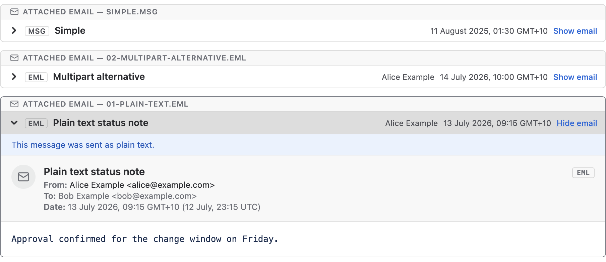
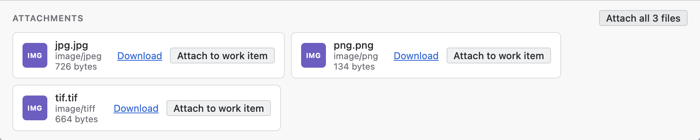

You open a work item, see an email attached to it, click the file, and get one of two things: a page of plain text starting with lines like Received: and Content-Type:, or a download prompt. The file is the email. Jira has stored it exactly as it was uploaded, but it shows it the way it shows any file it has no viewer for.

This guide explains what you are looking at, how to open the file on Windows and on a Mac, why renaming it or replacing it with a PDF does not help much, and how to read it on the work item without downloading anything.

## Why does the email open as raw text, or just download?

Jira previews the file types on its supported list: images, video, audio, PDFs, Microsoft Office and OpenDocument files, plain text and a few more ([Atlassian: Add an attachment to a work item](https://support.atlassian.com/jira-software-cloud/docs/add-an-attachment-to-an-issue/){:target="_blank" rel="noopener"}). No email format is on that list. Jira still accepts the file and the attachment strip still shows a preview tile for it ([Atlassian: Switch between the strip and list view](https://support.atlassian.com/jira-software-cloud/docs/switch-between-the-strip-and-list-view-for-attachments/){:target="_blank" rel="noopener"}), but the tile shows what Jira can make of the bytes. On our own site, an .eml file shows a thumbnail of its first lines of text, which are its header lines, and a .msg file shows a generic file icon.

Rendering email files on the work item is an open suggestion on Atlassian's tracker, [JRACLOUD-77500 "Improve the rendering of email files on issue view"](https://jira.atlassian.com/browse/JRACLOUD-77500){:target="_blank" rel="noopener"}, at Gathering Interest when we checked.

## What is the difference between a .eml file and a .msg file?

A .eml file is the email as it travelled between mail servers: a text file in the Internet Message Format ([RFC 5322](https://www.rfc-editor.org/rfc/rfc5322){:target="_blank" rel="noopener"}), with the headers at the top, then the body, then any attachments encoded as blocks of text. Gmail, Apple Mail, Outlook on the web and most other mail programs save a message this way, and every mail program can read one, because it is the format email is sent in.

A .msg file is Outlook's own format for a saved item ([Microsoft: Outlook Item (.msg) File Format](https://learn.microsoft.com/en-us/openspecs/exchange_server_protocols/ms-oxmsg/b046868c-9fbf-41ae-9ffb-8de2bd4eec82){:target="_blank" rel="noopener"}). Inside it is not text but a small container of storages and streams in the Compound File Binary format, the same structure as the old .doc and .xls files ([Microsoft: .MSG File Format, Part 1](https://learn.microsoft.com/en-us/archive/blogs/openspecification/msg-file-format-part-1){:target="_blank" rel="noopener"}). Classic Outlook for Windows writes one when you save a message or drag it to the desktop ([Microsoft: OlSaveAsType, "Outlook message format (.msg)"](https://learn.microsoft.com/en-us/office/vba/api/outlook.olsaveastype){:target="_blank" rel="noopener"}). Only software built to read that container can open it.

## Which program opens the file once I have downloaded it?

- **Windows.** Classic Outlook opens both formats. New Outlook for Windows opens .eml, .msg and .oft files when you drag one onto the reading pane, right-click it and choose Open with, or double-click it once Outlook is the default app for the type. A .msg needs a qualifying Microsoft 365 subscription ([Microsoft: Open .eml, .msg, and .oft files in new Outlook and Outlook on the web](https://support.microsoft.com/en-us/office/open-eml-msg-and-oft-files-in-outlook-60f71e69-e9a5-445b-b4dd-2e0d5aaf21d6){:target="_blank" rel="noopener"}).
- **Mac.** A .eml file opens in Apple Mail or Outlook for Mac. For a .msg file, Microsoft's page names only new Outlook for Windows and Outlook on the web, so the documented route on a Mac is to open Outlook on the web in a browser and drag the file onto its reading pane. We have found no Microsoft documentation saying Outlook for Mac opens a .msg file, but reach out and let us know if you have managed to make this work!
- **Any browser.** Outlook on the web opens both formats by drag and drop, from the same page.

One more thing before you download. On the work item, the email sits under Jira's permissions, where the people who manage your records can find it, and delete it when a customer asks or a retention period ends. In your Downloads folder it is a loose copy that none of that reaches. Many organisations keep correspondence in one place for exactly this reason, so check your records-management policy before downloading an email a customer sent you.

## Can I just rename the .msg file to .eml?

No. The extension is a label on the file; renaming it changes nothing inside. A .msg renamed to .eml is still the binary container, and a mail program that expects text headers finds none. We tried it: the renamed file's bytes are identical to the original's. Converting one to the other takes a program that reads one format and writes the other, and Outlook on the web saves an open message as either .eml or .msg ([Microsoft: Save an Outlook message as a .eml file](https://support.microsoft.com/en-us/office/save-a-message-as-a-file-4821bcd4-7687-4d6d-a486-b89a291a56e2){:target="_blank" rel="noopener"}).

## Why not attach a PDF or a screenshot instead?

For a reader who only needs the words, a PDF is fine. But it is a picture of one rendering, and the picture leaves things out. The headers go, and with them the record of who really sent the email and whether the receiving server's checks passed. The attachments go: a quote or invoice inside the email is not inside the PDF in any usable form. The links go, in the sense that the text stays but the real destination behind it does not. And you can no longer reply to it or forward it as a message. Someone also chose what to include, which matters when the work item is the record.

Keep the original file on the work item. If people need a quick look, put a PDF beside it rather than in its place.

## Can I read the email on the work item without downloading it?

We make an app for this, so read the rest of this section with that in mind.

[MSG & EML Email Viewer for Jira](/apps/email-viewer-jira) adds an Emails tab to the work item's Activity section. Every .msg and .eml file attached to the work item is rendered there as an email card: subject, sender, recipients, date, the body with its formatting and inline images, and the email's own attachments as tiles.

<figure class="shot">
  
  <figcaption>The Emails tab on a work item: the first attached email open as a card, two more collapsed to header rows, and the sidebar count beside it.</figcaption>
</figure>

There is nothing to configure, and the tab looks the same for everyone who can see the work item. The file is read from Jira as you, under Jira's own permissions, and parsed in your browser; it is stored nowhere else. A file inside the email has an Attach to work item button, so the invoice that arrived in the email goes onto the work item with one click.

<figure class="shot">
  
  <figcaption>The attachments at the foot of a rendered email, each with Download and Attach to work item.</figcaption>
</figure>

The app recognises an email by its content as well as its name, so a file a mail handler saved without an extension is shown too.

## What we checked, and when

On 5 November 2026, on our development Jira Cloud site, we attached an .eml file and a .msg file to a Jira Service Management request and looked at them in Jira's attachment panel: the .eml showed a thumbnail of its header lines as text, and the .msg a generic file icon. We renamed a .msg file to .eml and confirmed the bytes were unchanged. The Atlassian and Microsoft pages linked above were read the same day.

## Quick answers

**Why does Jira show the email as raw text?** Because a .eml file is text, and Jira previews it as text. Email is not among the file types Jira renders.

**Why does the .msg file download instead of opening?** A .msg is Outlook's binary format, which Jira has no viewer for, so the only action left is download.

**What is a .eml file?** The email as it was sent, in the standard Internet Message Format. Any mail program opens it.

**What is a .msg file?** Outlook's own saved-item format, a binary container rather than text. Outlook opens it.

**Which Windows program opens them?** Classic Outlook opens both. New Outlook for Windows opens both by drag and drop, with a Microsoft 365 subscription for .msg.

**Can I open a .msg file on a Mac?** Open Outlook on the web in a browser and drag the file onto the reading pane. Microsoft documents no route through Outlook for Mac.

**Can I rename a .msg file to .eml?** No. The bytes do not change, so a mail program still sees a binary file.

**Is a PDF of the email a good substitute?** For reading the words, yes. It loses the headers, the attachments and the real link targets.

**Can I read the email on the work item itself?** Yes, with a viewer app. Ours, MSG & EML Email Viewer for Jira, renders it in an Emails tab and can attach its files to the work item.

**Does the app change the attachment?** No. It reads the file as you and renders it in your browser.
