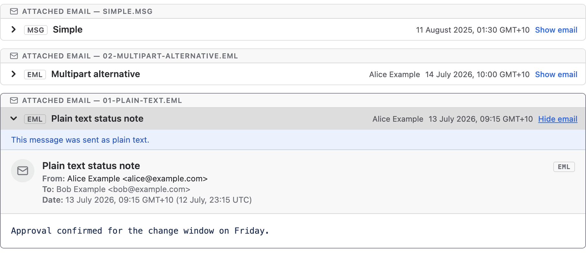

The email your team needs is sitting in your inbox. You can still read it, because desktop Outlook keeps a copy of what it has already downloaded, but Microsoft's mail service is down, so you can't forward it. Your colleagues who use Outlook in a browser can't access their email at all. The details in that email matter for work that is happening today.

This guide covers the ways of getting that email in front of your team without sending it: pasting it into chat, passing the file around, and putting it on the Jira work item or Confluence page the work belongs to.

## Why can't I just forward it?

Forwarding is sending, and sending is what an outage takes away. During the Microsoft 365 outage of 12 and 13 November 2026, Microsoft's own incident notice said users might be unable to reach their mailbox through Outlook on the web, the Outlook desktop app and mobile connections, and that delivery might be delayed ([ABC News live coverage](https://www.abc.net.au/news/2026-11-13/microsoft-outage-affects-users-worldwide/107381050){:target="_blank" rel="noopener"}). A forward written in desktop Outlook sits in the Outbox until the service comes back.

What desktop Outlook can usually still do is show you the mail it downloaded before the outage. So if you have desktop Outlook, the email still exists on your computer. The problem is sharing it with other people who don't.

## What about pasting it into Slack or a wiki?

It is the quickest thing to do, and for a two-line message it is enough. For anything that matters, a paste carries the wording and little else. The sender, the recipients and the date stay in your mailbox. Tables and signatures flatten, images drop out, and the files attached to the email are left behind. You can paste those in one by one, but it takes time, and the person reading the result has to reassemble an email from pieces.

A paste also cannot be checked for legitimacy. Once it is chat text, a reader has no way of telling it from the original, or of seeing who actually sent it and when. It doesn't include the email headers and details that someone might want to check.

One more thing about chat during this particular kind of outage: Microsoft Teams was affected by the November 2026 outage as well, so "put it in Teams" was not available either.

## What about sharing the email file itself?

This is better, because the file is the whole email: headers, formatting, images and attachments, exactly as it arrived. Getting the file out of Outlook is easy:

1. **Classic Outlook for Windows.** Drag the email from the message list to your desktop or a folder. Outlook saves it as a .msg file ([Microsoft: OlSaveAsType, "Outlook message format (.msg)"](https://learn.microsoft.com/en-us/office/vba/api/outlook.olsaveastype){:target="_blank" rel="noopener"}).
2. **Outlook for Mac.** Drag the email to the desktop. It is saved as a .eml file.

You can use any unaffected service for sharing the file (Slack, Dropbox, Google Drive).

The difficulty is at the other end, because it's not enough to just give someone a file - they need to be able to open it and read it. While an .eml file opens in most mail programs, a .msg file is Outlook's own binary format, and a colleague without classic Outlook has two documented ways to open one: new Outlook for Windows and Outlook on the web. Microsoft's page for those says an active internet connection is required ([Microsoft: Open .eml, .msg, and .oft files in new Outlook and Outlook on the web](https://support.microsoft.com/en-us/office/open-eml-msg-and-oft-files-in-outlook-60f71e69-e9a5-445b-b4dd-2e0d5aaf21d6){:target="_blank" rel="noopener"}), and both depend on the service that is down. So the colleagues who most need the email, the ones locked out of their browser mailbox, are the ones least able to open the file you send them. Our guide on [opening a .msg or .eml file](/guides/open-msg-or-eml-file-on-a-jira-work-item){:target="_blank" rel="noopener"} has more on the two formats.

## Should the email go on a Jira work item or a Confluence page?

If your team uses Jira or Confluence, there is a third option: put the file where the work is, and let everyone read it there, when they need it. The problem here is that on their own, Jira and Confluence can be used to store an email file but they don't display it. Instead an attached .msg shows as a file available for download and a .eml as raw text (as our guides on [Jira](/guides/open-msg-or-eml-file-on-a-jira-work-item){:target="_blank" rel="noopener"} and [Confluence](/guides/display-an-email-on-a-confluence-page){:target="_blank" rel="noopener"} describe). To make the email readable from within Jira or Confluence, you need an email viewer app. We make one for each product:

- **If the email describes work to be done**, such as a customer request, a bug report or an approval, attach it to the Jira work item for that work. Use our [MSG & EML Email Viewer for Jira](/apps/email-viewer-jira){:target="_blank" rel="noopener"}.
- **If the email is a record to keep**, such as a decision, a contract term or a supplier's commitment, attach it to the Confluence page that documents the subject. Use our [MSG & EML Email Viewer for Confluence](/apps/email-viewer){:target="_blank" rel="noopener"}.

## How do I show the email on a Jira work item?

Attach the .msg or .eml file to the work item as you would any file. With [MSG & EML Email Viewer for Jira](/apps/email-viewer-jira){:target="_blank" rel="noopener"} installed ([Marketplace listing](https://marketplace.atlassian.com/apps/463039643/msg-eml-email-viewer-for-jira){:target="_blank" rel="noopener"}), the work item has an Emails tab in its Activity section, and the email appears there as a card: subject, sender, recipients, date, the body with its formatting and inline images, and the email's own attachments as tiles.

<figure class="shot">
  
  <figcaption>The Emails tab on a work item: the attached email displayed as a card, readable by everyone who can see the work item.</figcaption>
</figure>

There is nothing to configure. Your colleagues open the work item in their browser and read the email; they need no mail program and no access to Outlook. A file inside the email, such as a quote or an invoice, has an Attach to work item button that puts it on the work item with one click. The email file is read from Jira as the person viewing it and parsed in their browser. Your email stays in your own Jira site. Cloudscript runs no server and keeps no copy.

## How do I show it on a Confluence page?

Attach the file to the page, then insert the macro from [MSG & EML Email Viewer for Confluence](/apps/email-viewer){:target="_blank" rel="noopener"} ([Marketplace listing](https://marketplace.atlassian.com/apps/2052211522/msg-eml-email-viewer-for-confluence){:target="_blank" rel="noopener"}) and choose the file. The email is displayed in place on the page, with its header, body, inline images and attachments. Our guide on [displaying an email on a Confluence page](/guides/display-an-email-on-a-confluence-page){:target="_blank" rel="noopener"} walks through it with screenshots.

## Who can see the email once it is there?

Everyone who can see the Jira work item or the Confluence page, and nobody else. Both apps read the file under Jira's or Confluence's own permissions, as the person viewing, so anyone who can't see a page or work item can't read an email that is attached to it either.

That is usually what you want, but check before attaching anything confidential. An email attached to a widely visible work item or page is readable by more people than were on the original To line, and so are its attachments. For a Confluence page, restrict the page first ([Atlassian: Change who can find content](https://support.atlassian.com/confluence-cloud/docs/add-or-remove-page-restrictions/){:target="_blank" rel="noopener"}). In Jira, choose a work item whose audience suits the email.

## Can we set this up today, and what does it cost?

Both our apps are free to try for 30 days, like every app on the Atlassian Marketplace ([Atlassian: Purchasing and licensing FAQ](https://www.atlassian.com/licensing){:target="_blank" rel="noopener"}). The trial has to be started by an administrator of your Atlassian site, so if that is not you, send them the Marketplace link. Installing takes a few minutes, and the Jira app needs no configuring before the first email is displayed. After the first 30 days the cost depends on the size of your Atlassian site and your site admin can see this on the Marketplace listing. If your site pays monthly, the app is billed from the end of the trial unless your admin removes it first.

## Is this worth doing when Outlook is working?

An outage on this scale is rare. The situation it creates is not. An email that lives only in one person's inbox is out of the team's reach whenever that person is asleep in another time zone, on leave, off sick, or, even worse, has left the company. And in those situations there is no status page to tell you when you'll get access back.

Keeping an important email on the work item or page it relates to removes that dependency. It also removes the search: the next person who needs it finds it beside the work, with no need to ask who was copied in or to rummage through a mailbox for it. The outage is a good prompt to move the emails your team relies on, and the habit is worth keeping after the service is back.

## What we checked, and when

The descriptions of what Jira and Confluence do with an attached email file, and of what our two apps display, come from checks on our own Jira Cloud and Confluence Cloud sites on 5 November 2026, set out in the two guides linked above. The Microsoft and Atlassian pages linked here were read on 13 November 2026, during the outage this guide refers to.

## Quick answers

**Can I forward an email while Outlook is down?** No. In an Exchange Online outage, desktop Outlook can usually still show the emails it has already downloaded, but nothing can be sent or received, and that includes a forward.

**Can I paste the email into Slack or a wiki instead?** Yes, but only the wording arrives. The sender, the recipients, the date, the formatting, the images and the attached files stay behind, and a reader cannot tell the paste from the original.

**How do I save an email from Outlook as a file?** In classic Outlook for Windows, drag the email to the desktop and it is saved as a .msg file. In Outlook for Mac, dragging it out saves a .eml file.

**Can a colleague without Outlook open the file?** A .eml opens in most mail programs. A .msg needs Outlook, and the routes Microsoft documents for people without classic Outlook all need Microsoft's online service, which is the part that is down.

**How do I show the email to the whole team?** Attach the file to the Jira work item or the Confluence page the work belongs to. With an email viewer app installed, such as our MSG & EML Email Viewer for Jira or MSG & EML Email Viewer for Confluence, the email is displayed there in full, with its sender, recipients, date, body, images and attachments.

**Who can see an email attached to a work item or a page?** Everyone who can see that work item or page. Check that before attaching a confidential email.

**Can we try the apps before buying?** Yes. Atlassian Marketplace apps can be trialled free for 30 days. A site administrator has to start the trial.

**Is this worth doing when Outlook is working?** Yes. An email that lives only in one person's inbox is out of reach whenever that person is asleep in another time zone, on leave, off sick or gone from the company.
